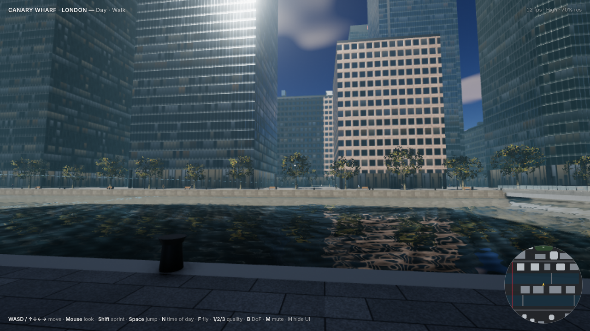
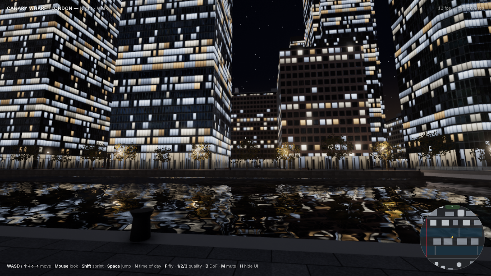
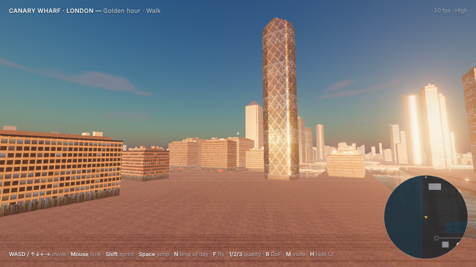
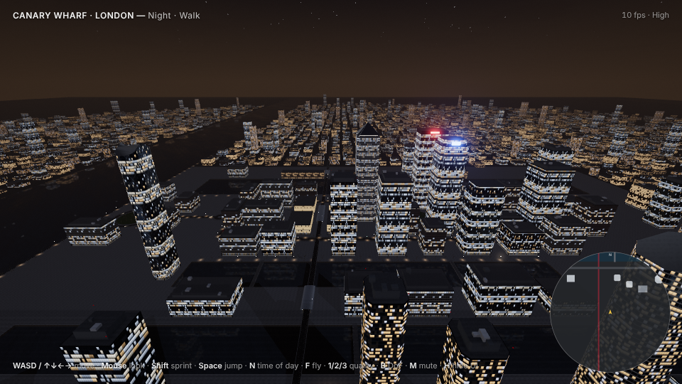

# Canary Wharf — London (real-time 3D)

A human-scale, walkable recreation of Canary Wharf, London E14 in the browser. It uses Three.js and WebGL2,
and every texture, model and sound is generated procedurally when the page starts. There are no image,
model or audio files, and the app makes **no network requests at runtime**.

**Requirements:** Node.js 20.19 or newer (Node 22 LTS recommended; `.nvmrc` included) and a desktop browser
with WebGL2.

```bash
git clone https://github.com/reindolfpratt/Opus5.5-High-test-Canary-Wharf-3D-web-app-.git
cd Opus5.5-High-test-Canary-Wharf-3D-web-app-
npm install
npm start          # opens http://localhost:5173 in your browser
```

`npm run dev` does the same without opening a browser tab.

Or the production build:

```bash
npm run build
npm run preview    # → http://localhost:4173
```

| Day, Middle Dock | Night, Middle Dock |
| --- | --- |
|  |  |
|  |  |

(Screenshots come from a CPU-only software renderer, so they show no GPU-specific detail.)

Click the page to lock the mouse and start walking. A desktop browser with WebGL2 is required (Chrome, Edge,
Firefox, or Safari 15+).

## Controls

| Key | Action |
| --- | --- |
| **W A S D** / **↑ ← ↓ →** | Walk forward, back and sideways |
| **Mouse** | Look around (click to lock the pointer, **Esc** to release) |
| **Shift** | Sprint |
| **Space** | Jump (in fly mode: go up; **C** or **Q** goes down) |
| **N** | Switch time of day: Day → Golden hour → Night |
| **F** | Switch between walking and flying (no collisions in fly mode) |
| **1 / 2 / 3** | Quality: Low / High / Ultra (the page reloads; the choice is saved) |
| **B** | Depth of field on/off |
| **M** | Mute or unmute the ambient audio |
| **H** | Hide or show the HUD and minimap |
| **G** | Open Google Street View of where you are standing, facing the way you are looking |

URL parameters: `?q=low|high|ultra`, `?time=day|golden|night`, `?cam=x,y,z,yawDeg,pitchDeg`, `?dynres=0`
(turns off dynamic resolution) and `?auto=1` (skips the start overlay, for example when taking screenshots).

## Compare with Google Street View

There are three ways to check the model against the real place. Each opens Google Street View in a new tab;
the app itself still makes no network requests.

1. **Pause screen (press Esc):** a list of 19 landmarks. **Go here** puts you at a ground-level viewpoint in the
   model, and **Street View ↗** opens the matching real viewpoint, facing the same way.
2. **Labels in the scene:** the nearest landmarks within about 280 m carry a label with a Street View link.
   Press Esc first so you can click it.
3. **The G key, or "Street View of this spot" at bottom left:** opens Street View for your current position and
   the direction you are facing.

Real coordinates come from OpenStreetMap and are stored in `src/geo.js`. Landmark links are placed relative to
each landmark's true position, so the subject is in frame. The G link converts model positions to latitude and
longitude using a best-fit transform. That transform is exact at the 19 landmarks and approximate between them.

## What's in the scene

Scale is 1 unit = 1 metre. The origin is One Canada Square, x points east and z points south. Eye height is 1.7 m.

- **Landmarks:** One Canada Square (235 m, notched plan, stainless-steel cladding, steel pyramid with an
  aviation strobe), 8 Canada Square (HSBC) and 25 Canada Square (Citi), both 200 m with lit crown bands,
  40 & 25 Bank Street, One Bank Street, 10 Upper Bank Street, 1 Churchill Place, Newfoundland (diagrid),
  Landmark Pinnacle, One Park Place, South Quay Plaza, Wardian, Pan Peninsula and One Park Drive. Around them
  are the Cabot Square buildings, the Cabot Place retail podiums, the Georgian West India Quay warehouses and
  about 60 other buildings with plausible footprints and heights.
- **Water:** North Dock, Middle Dock and South Dock, and the Thames frontage at Westferry Circus. The water has
  planar reflections and an animated normal map, and the docks have stone quay walls, granite coping,
  mooring bollards and walkable footbridges.
- **Stations and transport:** Crossrail Place (Elizabeth line) with its timber lattice roof, the glass canopies
  of the Jubilee line station in Jubilee Park, Underground roundel signs, and the DLR. The DLR has a concrete
  viaduct, four stations and driverless trains that stop at each station.
- **Streets:** traffic drives on the left, UK style. The roads have mandatory cycle lanes, double yellow lines,
  dashed centre lines and signal-controlled crossings with stop lines, studs, zig-zags and tactile paving.
  Kerbs are granite and the footways are raised. There are bus shelters, bollards, benches, bins, planters,
  K6 red telephone boxes, street lamps, the Cabot Square fountain and London plane trees in autumn colours.
- **Traffic:** London black cabs, cars, SUVs, vans, red double-decker buses that stop at bus stops, and a Met
  Police car in Battenburg livery with flashing beacons. Vehicles follow each other using the Intelligent
  Driver Model on closed lane loops, stop at red lights and slow down for curves. Brake lights work. Each lane
  is single-file and every car keeps a gap to the one in front, so vehicles never collide.
- **Crowds:** about 520 pedestrians on High, with skin, hair and business clothes (jackets, coats, trousers)
  varied per person. The walk cycle (hips, knees, shoulders) is computed on the GPU, and it also drives the
  shadow pass. People walk the footways, wander the plazas and quays, cross the footbridges, and wait at
  crossings until the green man shows.
- **Time of day:** day, golden hour and night. At night the window grids light up and you get street-lamp
  light pools, real point lights on the lamps nearest you, headlight beams on the road, stars, the moon and
  an orange light-pollution glow.

## Rendering techniques

- **PBR materials** throughout. Facades are painted procedurally into channel-packed maps (albedo,
  roughness+metalness, normal, emissive) with metre-scaled UVs that wrap continuously around each building.
  Each glass panel has a slight random tilt, so reflections break up the way they do on real glazing units.
- **Image-based lighting from the actual scene.** A cube camera captures the sky, the towers and the lit
  windows, and PMREM prefilters the result. Glass therefore reflects the neighbouring buildings as well as the
  sky. The capture is redone whenever the time of day changes.
- **Physically based sky** (Preetham, using three.js's `Sky`, with procedural clouds) plus a night layer.
  A CPU port of the same sky model sets the sun colour and the fog colour so they match the sky. Sky radiance
  is normalised so that a sunlit white wall is about 3× brighter than the horizon, as it is in real life.
- **Height fog** with sun in-scatter, integrated analytically along each view ray and added to every material.
  Combined with **screen-space god rays** this gives a volumetric look.
- **Shadows:** a camera-following PCF shadow map (2048² on High, 4096² on Ultra), snapped to texels so it
  doesn't shimmer. Tree leaves cast alpha-tested shadows and pedestrians cast animated shadows.
- **HDR post-processing chain:** a multisampled HDR scene target with a depth texture, then SSAO from depth
  (at half resolution with a bilateral blur), then screen-space reflections on wet streets (Ultra), then god
  rays, then camera motion blur, then depth of field, then bloom, then ACES filmic tone mapping with colour
  grading, vignette and dither. Anti-aliasing is 4× MSAA on High and Ultra, and FXAA on Low.
- **Performance:**
  - Instancing for crowds, traffic, trees, lamps, signals and street furniture.
  - Static meshes are merged per material into 420 m chunks, which keeps frustum culling working. This takes
    the total draw calls for the main, shadow and reflection passes from about 1,900 to about 670.
  - Small objects are on a separate layer, so the water reflection pass skips them.
  - The distant city (thousands of blocks out to about 3.6 km) is one low-detail merged proxy.
  - Pedestrians beyond 450 m are culled.
  - **Dynamic resolution** lowers the render scale to as little as 60% if the frame rate drops below 30 fps.

### Quality presets

| | Low | High (default) | Ultra |
| --- | --- | --- | --- |
| Render scale | 0.85× | 1× | up to 2× (HiDPI) |
| Anti-aliasing | FXAA | 4× MSAA | 4× MSAA |
| Shadows | 1024² | 2048² soft | 4096² soft |
| SSAO / god rays / motion blur | – | ✓ | ✓ |
| Screen-space reflections | – | – | ✓ |
| Water reflection | 256² | 512² | 1024² |
| Facade textures | 512×1024 | 512×1024 | 1024×2048 |
| Pedestrians | 220 | 520 | 900 |

## Project layout

```
src/
  main.js          bootstrap, frame loop, time of day, signals, aviation lights
  layout.js        geography: docks, roads, crossings, bridges, parks, building list (single source of truth)
  config.js        quality presets
  textures.js      procedural canvas textures (facades, paving, asphalt + UK markings, water normals, foliage…)
  materials.js     shared PBR materials
  sky.js           Preetham sky + night layer, sun/moon, height fog shader patch, environment capture
  post.js          HDR post-processing pipeline
  traffic.js       IDM traffic simulation + signal timing
  vehicles.js      procedural vehicle models
  crowd.js         GPU-animated instanced pedestrians
  controls.js      first-person controller + collisions
  audio.js         procedural Web Audio ambience
  ui.js            HUD, minimap, landmark labels, Street View list
  geo.js           model ↔ real lat/lng mapping (OpenStreetMap coordinates) + Street View links
  world/
    ground.js      land, docks, quay walls, Thames, water, lawns
    roads.js       carriageways, kerbs, footways, crossings, lane splines, height field
    buildings.js   building generator, landmarks, Crossrail Place, Jubilee canopies, distant city
    furniture.js   trees, lamps, signals, bollards, benches, phone boxes, bus shelters, fountain, railings
    dlr.js         DLR viaduct, stations, trains
    merge.js       static batching
```

## Accuracy notes

Measured against OpenStreetMap, the model is rotated about 16° from real north. After correcting for that, the
landmarks sit between 29 m and 187 m from their true positions: about 85 m on average, and 31 m or less for
Cabot Square and Westferry Circus. The biggest misplacements are the West India Quay warehouses (~187 m),
40 Bank Street (~183 m), South Quay Plaza (~182 m) and Jubilee Park (~144 m; in the model it sits too far
east). Run `layoutErrors()` from `src/geo.js` to get the full list.

The layout simplifies the real geography to keep it buildable and walkable. The towers, docks, DLR line and
squares are in the right relationship to each other. Footprints and heights are close to the real ones, but
facades are procedural rather than copies of the real buildings. Corporate crowns are lit generically, with
no trademarked logos. In reality most of Canary Wharf's road network runs on a lower level; here it is
simplified to a single surface loop and two dumbbell roads (West India Avenue and Marsh Wall).

## Licenses

- Project code: MIT (see `LICENSE`).
- three.js (MIT) and Vite (MIT) are installed from npm as dependencies and are not vendored into this
  repository.
- No third-party art, model, texture, HDRI or audio assets are used. Everything is generated at runtime.
  See `THIRD_PARTY_NOTICES.md`.
